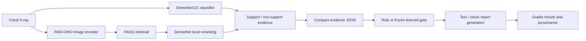

# CXR Evidence RAG

An evidence-guided chest X-ray report generation research project combining pathology classification, image retrieval, structured evidence, and multimodal language models.

Built with **Python · PyTorch · RAD-DINO · DenseNet121 · FAISS · scikit-learn · Gradio**.

> Research prototype. Generated reports require expert review and are not intended for clinical diagnosis. This repository publishes source code; datasets, trained weights, retrieval indexes, and study-level reports are supplied separately.

## What it does

- Classifies six target findings: atelectasis, cardiomegaly, edema, pleural effusion, pneumonia, and pneumothorax.
- Retrieves similar radiographs with pathology-adapted RAD-DINO embeddings and FAISS, then reranks candidates using DenseNet spatial features.
- Separates supporting and matched non-supporting evidence for each selected finding.
- Compresses evidence into a structured JSON contract before generating a constrained report.
- Compares rule-based evidence handling, a frozen learned gate, and two vision baselines.
- Provides a local Gradio interface for image uploads, comparison views, and traceable case history.

## Pipeline



The retrieval score combines global and local similarity:

```text
score = lambda_global * global_similarity + (1 - lambda_global) * local_similarity
```

Classifier probabilities select labels; they are excluded from reference ranking. When evaluating known studies, the query study is excluded from the retrieval gallery.

## Compared methods

| Method | Input and evidence |
| --- | --- |
| Structured rule | Classifier scores and structured support/non-support evidence with rule-based decisions |
| Structured learned gate | The same retrieval protocol with frozen scikit-learn gate artifacts |
| Baseline A | Classifier probabilities and the query image |
| Baseline B | Classifier probabilities, a retrieval summary, and the query image |

Experiment code records settings, response identifiers, actual API usage, routing decisions, and artifact provenance. The intended comparison uses identical `gpt-5.6-luna`, `reasoning_effort="high"`, and an 8192-token output cap across branches, with the local response cache disabled.

The historical evaluation protocol uses **206 studies**. Clinical text evaluation uses the common **205-study cohort**, excluding study 1615 because its reference findings and impression are both empty. Section-specific text comparisons use nonempty references: 163 Findings and 204 Impression. These counts describe the local research protocol; the underlying reports and result artifacts are not distributed here, and this publication does not rerun or independently revalidate the historical metrics.

## Getting started

Use Python 3.11+ and an NVIDIA GPU with a CUDA-enabled PyTorch installation for neural inference and clinical evaluators. Check CUDA before starting; do not silently fall back to CPU.

```powershell
git clone https://github.com/Lvquank/cxr-evidence-rag.git
cd cxr-evidence-rag
python -m venv .venv
.\.venv\Scripts\Activate.ps1
python -m pip install -r requirements.txt
# Install a CUDA-enabled PyTorch build appropriate for your GPU and driver.
python -c "import torch; assert torch.cuda.is_available(), 'CUDA is required'; print(torch.cuda.get_device_name(0))"
Copy-Item .env.example .env
```

Set your own API key in `.env`. Model access depends on the configured API endpoint; the experimental model identifier is preserved rather than substituted automatically.

Before inference, prepare the dataset, trained checkpoints, gallery, and frozen gate files listed in [Setup and external artifacts](docs/SETUP.md). A fresh clone contains the implementation, not a ready-to-run pretrained system. Unit checks that use synthetic inputs can run without these research assets.

### Local interface

Once the research environment and external artifacts are ready:

```powershell
$env:CXR_RESEARCH_PYTHON = (Get-Command python).Source
.\StartGradio.ps1
```

Open `http://127.0.0.1:7860`. The launcher creates a separate environment for the Gradio dependencies. Historical research views require the original local result artifacts. Starting the interface does not generate reports; submitting a new analysis can incur API charges.

### One-image workflow

```powershell
python scripts/test_classifier_to_retriever.py --image_path path/to/xray.png --device cuda --output_json outputs/my_case/evidence.json
python scripts/run_full_pipeline.py --input outputs/my_case/evidence.json --output outputs/my_case/report --model gpt-5.6-luna --reasoning-effort high --max-output-tokens 8192 --no-cache
```

For a known evaluation study, also pass `--exclude_study_id STUDY_ID` to the evidence command. Use a new output directory for each experiment and preserve existing runs. Run `--help` on individual scripts for their inputs and options. Some legacy scripts retain older defaults; pass CUDA and generation settings explicitly.

## Repository map

| Path | Purpose |
| --- | --- |
| `src/data/` | Dataset parsing, metadata normalization, and image preprocessing |
| `src/embeddings/` | RAD-DINO, DenseNet, and pathology projection modules |
| `src/retriever/` | FAISS retrieval, spatial reranking, and evidence status logic |
| `src/llm_client.py`, `src/prompts.py` | Responses API client, constrained prompts, and report validation |
| `scripts/` | Ingestion, inference, training helpers, comparisons, and evaluation |
| `notebooks/`, `model/*.ipynb` | Training and embedding workflows |
| `gradio_app/` | Local interface, worker adapter, and case presentation |
| `config/` | Configuration examples, frozen thresholds, and target ontology |
| `tests/` | Regression checks for evidence, routing, metrics, and interface behavior |

## Validation

These focused checks mock API calls and use synthetic evidence. They do not run neural inference or recompute clinical results:

```powershell
python -m unittest discover -s tests -p test_llm_pipeline.py -v
python -m unittest discover -s tests -p test_llm_evaluation.py -v
```

Other tests may require the original dataset, checkpoints, historical reports, or a GPU. See [Architecture](docs/ARCHITECTURE.md) and [third-party components](docs/THIRD_PARTY.md) for implementation details and attribution.

## Limitations

- Retrieval evidence is supporting context, not a diagnostic verdict.
- The optional ResNet50 interface adapter reuses DenseNet thresholds and gate settings; it has not been separately calibrated or validated.
- Frozen learned gate artifacts must be restored unchanged. Known studies use their held-out fold; unseen uploads use the recorded deployment fallback and are not out-of-fold evaluations.
- Missing reference text must remain missing. Validate all 206 study identities and report provenance before recomputing metrics, and disclose the common clinical cohort.
- Do not commit API keys, patient images, source report CSVs, model binaries, or generated case histories. The ignore rules exclude these local assets.
